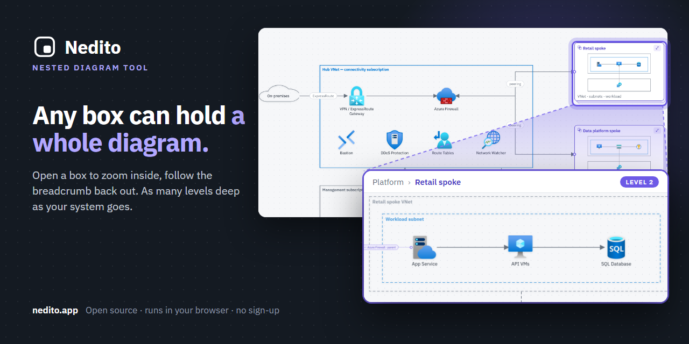
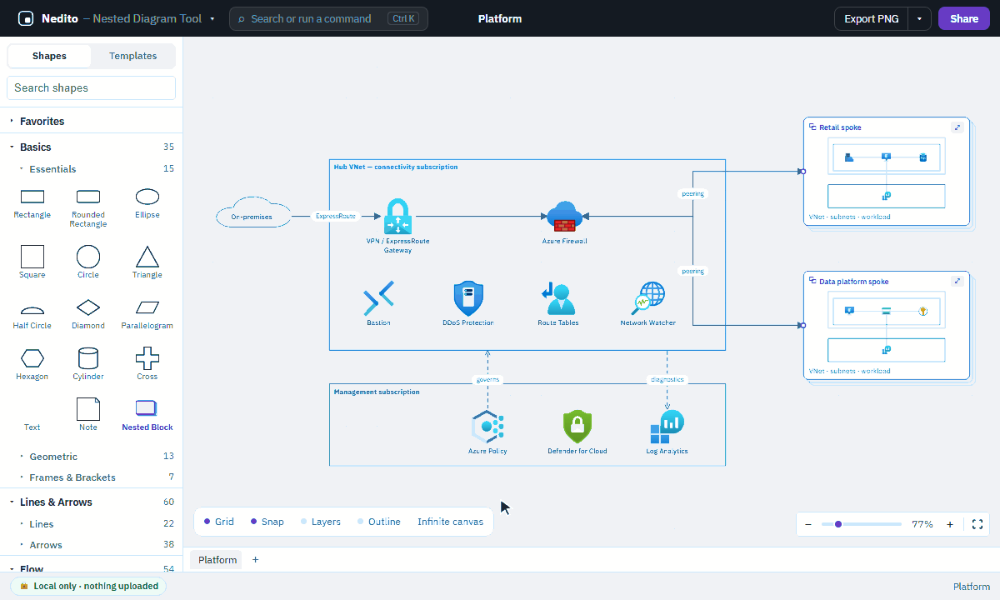
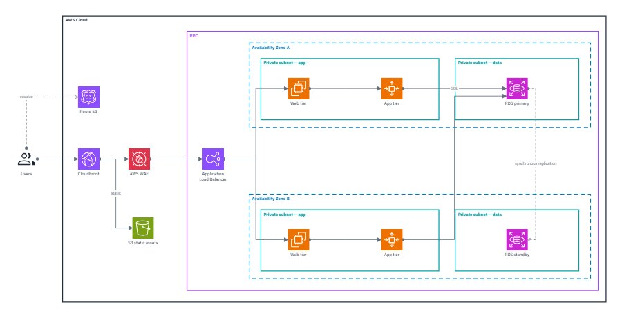
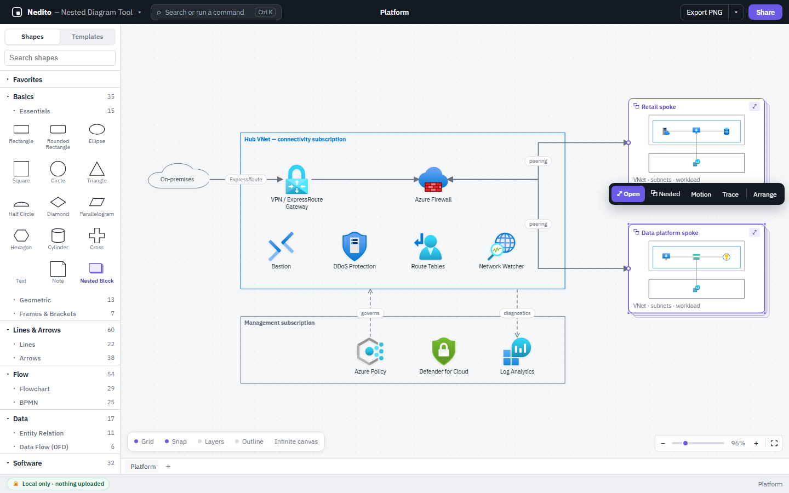
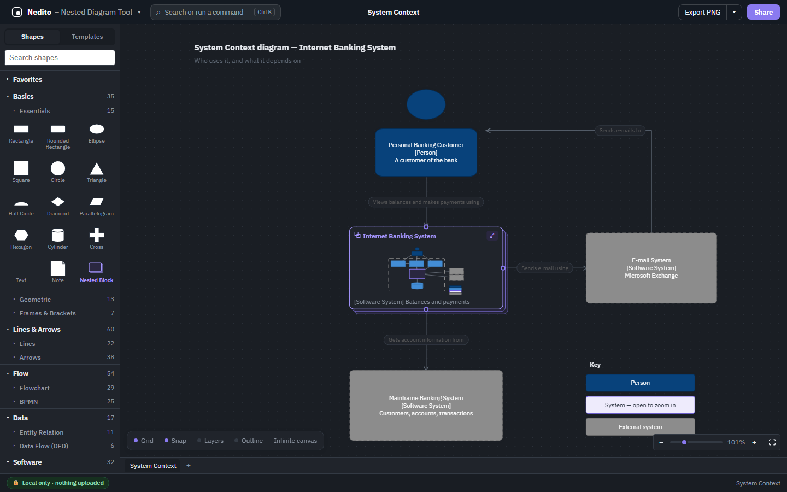

<p align="center">
  
</p>

<h1 align="center">Nedito</h1>

<p align="center">
  <b>Nested Diagram Tool</b> — diagrams where any box can hold a whole diagram of its own.
</p>

<p align="center">
  <a href="https://nedito.app"><b>Open the app</b></a> ·
  <a href="docs/FORMAT.md">File format</a> ·
  <a href="#contributing">Contributing</a> ·
  <a href="SECURITY.md">Security</a>
</p>

<p align="center">
  
  
  
  
</p>

<p align="center">
  
</p>

Every architecture diagram hits the same wall. You start with five boxes, someone asks what is
inside the payment service, and you either cram it all in or split it into files nobody opens.

Nedito takes a third option. **Any box can be a Nested Block**: in its parent it shows a live
miniature of what is inside it, and opening it zooms into that diagram as a full canvas, with a
breadcrumb to climb back out — as many levels deep as the subject needs. Around that, it is the
diagram editor you would expect: shapes, lines, pages, layers, templates, and the official Azure,
AWS and Google Cloud icons.

It runs in the browser at **[nedito.app](https://nedito.app)**, with nothing to install and no
account.

## See it

**Open a box, look inside, climb back out.** The miniature on each Nested Block is drawn from what
is really inside it, so it never goes stale. Lines that cross the boundary arrive inside as ghost
links, named after where they come from.

<p align="center">
  
</p>

**Diagrams that move.** Lines can carry flowing traffic, packets or throughput, and shapes can
pulse or show their health. Motion is saved with the diagram, every kind has a still form for
print, and the Animated image export turns a level into a GIF — this one was made by it:

<p align="center">
  
</p>

<table>
  <tr>
    <td width="50%"></td>
    <td width="50%"></td>
  </tr>
  <tr>
    <td align="center">A floating context bar over the selection, instead of side panels</td>
    <td align="center">Dark mode, here with the C4 model template</td>
  </tr>
</table>

## What it does

| | |
|---|---|
| **Nesting** | Nested Blocks with live miniatures, ports that carry lines inside, ghost links, breadcrumbs, unlimited depth. Turn any selection into a Nested Block, and trace what a shape touches across every level. |
| **Editing** | Shapes, curved, straight and orthogonal lines with waypoints, labels with rich text, groups, layers, pages, find and replace, alignment, snapping, undo across levels, and a command palette (Ctrl+K). |
| **Library** | 18 sections — flowchart, BPMN, UML, C4, entity relation, data flow, network and more — plus the official Azure, AWS and Google Cloud architecture icons, and animated icons. |
| **Templates** | 38 ready-made diagrams, from flowcharts and C4 models to cloud landing zones, several of them nested. |
| **Motion** | Flow, packets and throughput on lines; pulse and health on shapes; and Build, Walkthrough and Spotlight presentation modes. |
| **Export** | PNG, an editable PNG that reopens as the diagram, SVG, PDF, print, PowerPoint (each Nested Block a Slide Zoom), Word, and animated GIF. |
| **Share** | A link that opens the diagram read-only, and a copied image that opens the full diagram when clicked. |
| **Import** | `.nedito` files, editable PNGs, Word exports, and draw.io files as a best-effort import that says what it could not carry across. |

## Where your work lives

Nothing is uploaded. There is no account and no server holding your diagrams: the page is served as
static files, and the diagram you are working on is kept in this browser's local storage, saved as
you go. A share link carries the diagram inside the part of the URL after `#`, which browsers do not
send to the server.

The flip side is that nobody else has a copy. Clearing this browser's data, or switching browser or
machine, leaves your work behind, and it cannot be recovered for you. Download your file (app menu ›
Save a copy, or Export) to keep it, and to move or share it.

## The file format

A Nedito document is a single readable JSON file with the `.nedito` extension. Its first two keys
say what it is — `"format": "nedito"` and `"formatVersion"` — and its keys are written in a stable
order, so documents diff cleanly in Git. Nesting is by reference: a document is a flat map of
diagrams, and a Nested Block names the diagram it holds. The schema, version by version, is in
[`docs/FORMAT.md`](docs/FORMAT.md).

Every older version still opens, migrated on load (`src/file/migrations/`), and so do files from
before the product was renamed from DeepDraw: the `.deepdraw` extension and its editable
`.deepdraw.png` images (`LEGACY_BRANDS` in [`src/app/brand.ts`](src/app/brand.ts)).

## Running it locally

You need Node.js and npm. Commands work in PowerShell as written; the project is developed on
Windows.

```powershell
npm install
npm run dev          # the app, with hot reload, at http://localhost:5173
```

| Task | Command |
|---|---|
| Unit tests (Vitest) | `npm run test` (or `npm run test:watch`) |
| End-to-end tests (Playwright) | `npm run test:e2e` — the first time, install the browser with `npx playwright install chromium` |
| Run one balanced part of the end-to-end suite, as CI does | `node scripts/e2e-shard.mjs <part> 4` (`--plan 4` shows the split) |
| Lint (ESLint) | `npm run lint` |
| Type check | `npx tsc -b` |
| Production build | `npm run build`, then `npm run preview` to serve `dist/` |
| Format (Prettier) | `npm run format` |
| Regenerate the PNG app icons from their SVG | `npm run icons` |
| Measure pan and zoom frame times | `npm run perf` (see the header of `scripts/perf-pan.mjs`) |
| Regenerate the README's pictures | `npm run readme-images`, with `npm run dev` running |
| Regenerate the repository's social preview image | `npm run social-preview`, with `npm run dev` running (see `docs/social-preview/`) |

Built with React 18, TypeScript, Vite, [React Flow](https://reactflow.dev) and Zustand. The
production build is static files, served from a Cloudflare Worker (`wrangler.jsonc`).

<details>
<summary><b>Repository layout</b></summary>

```
src/
  app/            the shell: top bar, app menu, command palette, dialogs, brand, breadcrumbs
  canvas/         React Flow setup, custom shapes and lines, interactions, motion and presentation
  context-bar/    the floating bar over a selection, and its popovers
  format-panel/   the formatting controls those popovers and the Page popover show
  nesting/        Nested Blocks: ports, ghost links, navigation, trace, convert to nested
  library/        the shape library sidebar, its lazily loaded stencil sections, search
  model/          document types, validation, the store and its actions, undo
  file/           the .nedito format and migrations, PNG/SVG/PDF/GIF export, autosave, draw.io import
  export/         PowerPoint and Word export
  share/          share links, the read-only viewer, copy image with live link
  onboarding/     the first visit, the tour, the export reminder
  templates/      the template catalogue
  styles/         design tokens, global styles, motion
tests/e2e/        Playwright tests; unit tests sit next to the code they test
docs/             the file format, specs, audits, and the README's pictures; docs/archive/ for delivered specs
examples/         worked example documents, rebuilt and checked by tests
scripts/          icon generation, the performance measurement, the end-to-end split, the pictures
public/           the app icons (the typeface comes from npm, @fontsource)
licenses/         the full text of third-party licences NOTICE refers to
```

</details>

## Contributing

Bug reports, ideas and pull requests are welcome. For a bug, say what you did, what you expected
and what happened, and attach the diagram if it matters: export it yourself, because nothing in the
app sends us your work.

`main` is protected and always working. Each change is its own short-lived branch off `main`:

1. Branch (`feat/…`, `fix/…`, `docs/…`).
2. Before opening a pull request, run the fast checks and get them green — `npm run test`,
   `npm run lint`, `npx tsc -b`, `npm run build` — plus the end-to-end tests for the area you
   changed (`npx playwright test tests/e2e/<spec>`).
3. Open the pull request with what changed and how you checked it.
4. One pull request open at a time: the next branch starts after the last one merges.

Every pull request runs the full sweep in GitHub Actions (`.github/workflows/ci.yml`), the
end-to-end tests split across four machines, and must be up to date with `main` and green before
it merges. Commits use conventional messages (`feat(canvas): …`), and new dependencies need a
stated reason.

[`CLAUDE.md`](CLAUDE.md) holds the full working agreements and the product rules,
[`PROGRESS.md`](PROGRESS.md) the work queue, and [`CLAUDE_HISTORY.md`](CLAUDE_HISTORY.md) every
past decision and why.

## Security

Please report a security problem privately, as [`SECURITY.md`](SECURITY.md) describes, not in a
public issue.

## Licence and attribution

Nedito is open source under the **Apache License 2.0** — see [`LICENSE`](LICENSE).

It ships third-party assets, each under its own terms, listed with their sources in
[`NOTICE`](NOTICE):

| What | Used for | Terms |
|---|---|---|
| Microsoft Azure architecture icons | The Azure section of the shape library | Microsoft's icon terms: architecture diagrams, training and documentation |
| AWS architecture icons | The AWS section | AWS Architecture Icons guidelines |
| Google Cloud icons | The Google Cloud section | Google Cloud's icon usage guidelines |
| Google Material Symbols | Icons in the General, Misc, Arrows, Network and Business sections | Apache License 2.0 |
| IBM Plex Sans and Mono | The interface typeface, embedded in SVG exports | SIL Open Font License 1.1 ([full text](licenses/IBM-Plex-OFL-1.1.txt)) |

The vendor icons and trademarks belong to their owners, and Nedito is not affiliated with them.
draw.io is a trademark of its owner, named here only to say which files Nedito can import.

---

<p align="center">
  Built by two buddies: a cloud architect with the idea and the opinions, and Claude, an AI from
  Anthropic, who wrote most of the code. Arguments were had. Mostly about fonts.
</p>
